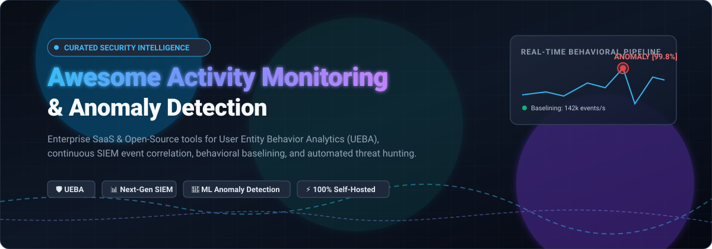

  

# 🛡️ Awesome Activity Monitoring & Anomaly Detection 🔍

  
  
  
  
  

---

> 🚀 **A curated directory of top-tier Enterprise SaaS solutions and Open-Source tools for Activity Monitoring, User & Entity Behavior Analytics (UEBA), SIEM correlation, and Real-Time ML Anomaly Detection.**

Whether you are evaluating commercial cloud-native platforms with automated root-cause AI or architecting an entirely self-hosted detection engineering pipeline with open-source SIEM and runtime eBPF telemetry, this guide details technical capabilities, pricing baselines, free tier limits, and GitHub community momentum.

---

## 📑 Table of Contents

- [🌐 Sector Overview & Market Dynamics](#-sector-overview--market-dynamics)
- [🏢 SaaS & Hosted Commercial Platforms](#-saas--hosted-commercial-platforms)
- [🔓 Open-Source GitHub Projects](#-open-source-github-projects)
  - [1. Elasticsearch (`elastic/elasticsearch`)](#1-elasticsearch-elasticelasticsearch)
  - [2. Osquery (`osquery/osquery`)](#2-osquery-osqueryosquery)
  - [3. Wazuh (`wazuh/wazuh`)](#3-wazuh-wazuhwazuh)
  - [4. Apache Doris (`apache/doris`)](#4-apache-doris-apachedoris)
  - [5. CrowdSec (`crowdsecurity/crowdsec`)](#5-crowdsec-crowdsecuritycrowdsec)
  - [6. OpenSearch (`opensearch-project/OpenSearch`)](#6-opensearch-opensearch-projectopensearch)
  - [7. Sigma (`SigmaHQ/sigma`)](#7-sigma-sigmahqsigma)
  - [8. Falco (`falcosecurity/falco`)](#8-falco-falcosecurityfalco)
  - [9. Zeek (`zeek/zeek`)](#9-zeek-zeekzeek)
  - [10. Suricata (`OISF/suricata`)](#10-suricata-oisfsuricata)
  - [11. Anomalib (`open-edge-platform/anomalib`)](#11-anomalib-open-edge-platformanomalib)
  - [12. Security Onion (`Security-Onion-Solutions/securityonion`)](#12-security-onion-security-onion-solutionssecurityonion)
  - [13. Velociraptor (`Velocidex/velociraptor`)](#13-velociraptor-velocidexvelociraptor)
  - [14. TheHive (`TheHive-Project/TheHive`)](#14-thehive-thehive-projectthehive)
  - [15. VictoriaLogs (`VictoriaMetrics/VictoriaLogs`)](#15-victorialogs-victoriametricsvictorialogs)
  - [16. Security Shallots (`benolenick/security-shallots`)](#16-security-shallots-benolenicksecurity-shallots)
- [💡 Architectural Guidance: Building Your Detection Pipeline](#-architectural-guidance-building-your-detection-pipeline)
- [📈 Star History](#-star-history)
- [🤝 How to Contribute](#-how-to-contribute)
- [💖 Support & Sponsorship](#-support--sponsorship)
- [⚖️ Disclaimer & Compliance](#-disclaimer--compliance)

---

## 🌐 Sector Overview & Market Dynamics

The global market for **Activity Monitoring, SIEM, and UEBA** is projected at **$9.5B–$12.0B in 2025–2026** (with core SIEM standing at ~$8.4B–$12B and standalone UEBA expanding past $4.1B at a rapid CAGR exceeding 35%). 

- **Market Concentration:** The sector is **moderately concentrated at the top**, driven by tech and security conglomerates (Cisco/Splunk, Microsoft Sentinel, Datadog) that bundle behavioral analytics and AI assistants directly into multi-product enterprise licenses.
- **Dynamic Fragmentation:** Concurrently, the operational perimeter remains **heavily fragmented** across specialized niche innovators (unsupervised network AI, agentless cloud detection) and a thriving **open-source ecosystem** (Wazuh, Falco, Zeek, OpenSearch) providing sovereign, vendor-neutral detection pipelines.

---

## 🏢 SaaS & Hosted Commercial Platforms

The following table compares leading commercial platforms ranked by **company scale (valuation / market capitalization in descending order)**, highlighting specific entry-tier pricing and concrete free tier/trial thresholds.

| Company / Product | Valuation / Revenue | Starting Price | Free Tier / Trial Limits | Key Capabilities & Trade-offs |
| :--- | :--- | :--- | :--- | :--- |
| **Datadog Security Monitoring** | **~$70B+ Market Cap** ($2.68B+ ARR) | **$15/host/mo** (Pro); **$23/host/mo** (Enterprise with ML Anomaly Detection); **$34/host/mo** (DevSecOps) | **14-day free trial** (Full platform access, no credit card required); permanent free tier capped at 5 hosts with 1-day metric retention (no security ML) | Cloud security monitoring with anomaly detection and correlation. Best for teams already using Datadog observability; trade-off is ML anomaly detection is gated to Enterprise tier and per-host infrastructure costs scale rapidly. |
| **Splunk Enterprise Security** (Cisco) | **$28B Acquisition Valuation** (~$4B Revenue) | **$759/GB/day/yr** (ES Essentials at 100–199 GB/day); **$1,783.65/GB/day/yr** (ES Premier) | **14-day free trial** for Splunk Cloud Platform (up to 5 GB/day data limit, hosted sandbox); **60-day trial** for Splunk Enterprise (500 MB/day limit, converts to perpetual free license capped at 500 MB/day without alerts/auth) | Enterprise SIEM with deep detection content and UEBA (UEBA included only in Premier). Best for large enterprises with heavy custom detection requirements; costs scale steeply with ingest volume. |
| **Zoho (ManageEngine Log360 / Anomaly Watch)** | **~$12.4B–$15B Estimated Valuation** (~$1.5B Revenue) | **$1,095/yr** (Log360 Cloud Professional, 10 log sources); **$1,395/yr** (Log360 Cloud Enterprise with UEBA); On-prem from **$495/yr** | **30-day free trial** (Log360 Enterprise with full UEBA, SOAR, and threat analytics, no credit card required); permanent free edition capped at 5 log sources without UEBA/correlation | Integrated SIEM and user behavior monitoring across Cloud and on-prem assets. Cost-effective for mid-market and Zoho/ManageEngine environments; trade-off is less advanced network traffic behavioral modeling than pure-play NDRs. |
| **Dynatrace Davis AI** | **~$12.4B Market Cap** (~$1.4B+ Revenue) | **$0.01/host-hr (~$7/host/mo)** (Foundation); **$0.04/host-hr (~$29/host/mo)** (Infrastructure); **$58/mo per 8 GiB host** (Full-Stack APM & Davis AI) | **15-day free trial** (Full platform access including Davis AI and Grail, no credit card required); no permanent free tier (public playground with preloaded data available) | Causal AI for root cause analysis and anomaly detection. Best for deterministic root cause analysis rather than simple correlated alerts; trade-off is consumption-based module billing makes costs difficult to forecast. |
| **Elastic Security** | **~$9.3B Market Cap** (~$1.3B+ Revenue) | **~$131/mo** (Elastic Cloud Platinum with unsupervised ML Anomaly Detection); Standard starts at **$99/mo** (no ML) | **14-day free trial** (Elastic Cloud with up to 1 deployment capped at 8 GB total RAM and 3 Serverless projects, no credit card required); Basic self-managed edition is perpetual free but lacks ML anomaly detection | Open-core SIEM with out-of-the-box detection rules. Best for teams already running Elasticsearch; trade-off is behavioral and ML anomaly detection requires Platinum tier. |
| **New Relic Alerts** (Francisco Partners & TPG) | **$6.5B Acquisition Valuation** (~$926M Revenue) | **$349/user/yr** (Pro full platform user) + **$0.40/GB** (Original data ingest) or **$0.60/GB** (Data Plus) | **Perpetual Free Tier**: **100 GB/month ingest**, 1 full platform user, unlimited basic users; paid tier free trial is **30 days** | Full-stack observability platform with automated anomaly alerts and baselining. Best for unified APM and infrastructure telemetry without per-host charges; trade-off is anomaly detection is part of general observability rather than a dedicated security SIEM. |
| **Darktrace** (Thoma Bravo) | **$5.3B Acquisition Valuation** (~$680M Revenue) | **~$20,000/yr** (Starting enterprise baseline, scales by monitored IP addresses & modules) | **30-day Proof of Value (POV) free trial** (Vendor-assisted deployment across production network/cloud/email environment, no financial commitment) | Self-learning AI-driven network detection and response (NDR) with unsupervised anomaly detection. Best for autonomous behavior baselining across zero-trust networks; trade-off is high cost and complex configuration tuning. |
| **Exabeam New-Scale Fusion** | **~$2.4B–$2.5B Valuation** (~$200M+ Revenue) | **~$31,000/yr** (Security Log Management baseline at ~50 GB/day); **~$36,000–$75,000/yr** (Full Fusion SIEM with UEBA) | **30 to 60-day Proof of Value (POV) guided trial** (Coordinated through sales engineering to ingest telemetry and train UEBA baselines; no instant self-service trial) | Cloud-native SIEM centered around User and Entity Behavior Analytics (UEBA) and automated timeline reconstruction. Best for SOC teams prioritizing behavioral deviation over static rules; trade-off is complex onboarding and tuning. |
| **Sumo Logic Cloud SIEM** (Francisco Partners) | **$1.7B Acquisition Valuation** (~$300M Revenue) | **$0.25/credit** (Credits model) or **$1.50/credit** (Flex model); Cloud SIEM ingest metered at **40 credits/GB** | **30-day free trial** (Ingest up to 1 GB/day, 20 users, 30 days retention) or 14-day agentic sandbox; permanent free tier capped at **1.25 credits/day (~500 MB/day)**, 3 users, 7-day retention | Cloud-native SIEM with behavioral analytics and automated insight generation. Best for cloud-first environments; trade-off is Cloud SIEM ingest is the highest-priced data category on the platform (40 credits/GB). |
| **Rapid7 InsightIDR** | **~$1.05B Market Cap** (~$820M Revenue) | **$2,156/mo (~$25,870/yr)** billed annually (500 asset baseline minimum pack, ~**$5.89/asset/mo**) | **30-day free trial** (Full InsightIDR access for testing endpoint agents, log search, and UEBA analytics upon sales validation) | Cloud SIEM with integrated endpoint detection and behavioral analytics. Best for mid-market to enterprise SOCs seeking managed detection rules; trade-off is steep minimum asset tiers and overage rates. |

---

## 🔓 Open-Source GitHub Projects

Below are the premier open-source solutions for activity monitoring, anomaly detection, host/network telemetry, and SIEM architectures—**sorted in descending order by GitHub community stars**. Beside each project, the Stars_Badge directly links to that repository's stargazers page.

### 1. Elasticsearch (`elastic/elasticsearch`)

- **Description**: Distributed, RESTful search and analytics engine that acts as the foundational backbone for enterprise security log analytics and activity monitoring.
- **Anomaly Detection Capabilities**: Powers Elastic Security; features unsupervised machine learning jobs that baseline statistical event distributions (available in Platinum/Cloud tiers) and provides extensive Kibana security rules.
- **Tech Stack & License**: Java; Elastic License 2.0 / SSPL.
- **Best For**: Large-scale log aggregation, distributed search, and high-throughput security event index pipelines.

### 2. Osquery (`osquery/osquery`)

- **Description**: Exposes an entire operating system as a high-performance relational database, enabling SQL queries for host activity monitoring and anomaly detection.
- **Anomaly Detection Capabilities**: Enables scheduled differential queries on processes, open network sockets, kernel extensions, and logged-in users to spot anomalous persistence mechanisms and unexpected behavioral drift.
- **Tech Stack & License**: C++, C; Apache 2.0.
- **Best For**: Endpoint visibility, compliance auditing, and continuous process/file integrity telemetry.

### 3. Wazuh (`wazuh/wazuh`)

- **Description**: Complete open-source XDR and SIEM platform offering endpoint monitoring, log analysis, threat intelligence mapping, and regulatory compliance validation.
- **Anomaly Detection Capabilities**: Preconfigured with thousands of correlation rules mapped to MITRE ATT&CK; includes File Integrity Monitoring (FIM), rootkit detection, and active automated response without proprietary paywalls.
- **Tech Stack & License**: C, Python; GPLv2.
- **Best For**: Organizations seeking a battle-tested, fully free self-hosted SIEM for host intrusion detection and compliance monitoring.

### 4. Apache Doris (`apache/doris`)

- **Description**: High-performance, real-time analytical database based on MPP architecture, engineered for lightning-fast SQL queries over massive streaming event telemetry.
- **Anomaly Detection Capabilities**: Powers security lakes and behavioral baselines by executing sub-second aggregations, joins, and time-series deviation queries over petabytes of user and network logs.
- **Tech Stack & License**: C++, Java; Apache 2.0.
- **Best For**: Building hyperscale log lakes and real-time behavioral analytical backends.

### 5. CrowdSec (`crowdsecurity/crowdsec`)

- **Description**: Collaborative open-source behavioral intrusion prevention and activity monitoring engine that analyzes visitor behavior and crowdsources threat intelligence.
- **Anomaly Detection Capabilities**: Parses system, web, and container logs using declarative YAML scenarios to detect behavioral anomalies (brute force, scraping, L7 DDoS, port knocking) and blocks attacks via remediations (bouncers).
- **Tech Stack & License**: Go; MIT License.
- **Best For**: Distributed behavioral defense, perimeter security, and global threat intelligence sharing.

### 6. OpenSearch (`opensearch-project/OpenSearch`)

- **Description**: 100% open-source search and analytics suite offering community-driven log management, SIEM plugins, and built-in anomaly detection plugins.
- **Anomaly Detection Capabilities**: Includes native Random Cut Forest (RCF) machine learning algorithms for real-time unsupervised anomaly detection directly on streaming time-series log data without commercial licensing tiers.
- **Tech Stack & License**: Java; Apache 2.0.
- **Best For**: Teams needing pure Apache 2.0 open-source SIEM log storage with built-in ML anomaly detection algorithms.

### 7. Sigma (`SigmaHQ/sigma`)

- **Description**: The industry standard generic rule format for SIEM systems, describing malicious activity and behavioral patterns in a platform-agnostic specification.
- **Anomaly Detection Capabilities**: Over 3,000 community-vetted detection rules that convert directly to Splunk, Elastic, Wazuh, OpenSearch, and Microsoft Sentinel queries for behavioral threat hunting.
- **Tech Stack & License**: YAML, Python; DRL (Detection Rule License).
- **Best For**: Standardizing behavioral detection logic and sharing threat correlation patterns across heterogeneous security stacks.

### 8. Falco (`falcosecurity/falco`)

- **Description**: Cloud-native runtime security and behavioral monitoring tool originally created by Sysdig, now a graduated CNCF project.
- **Anomaly Detection Capabilities**: Uses eBPF kernel probes to inspect raw syscalls in real time, detecting anomalous container behaviors, unexpected privilege escalation, and unauthorized shell executions with near-zero overhead.
- **Tech Stack & License**: C++, eBPF; Apache 2.0.
- **Best For**: Kubernetes cluster runtime protection, container workload monitoring, and kernel-level behavioral alerting.

### 9. Zeek (`zeek/zeek`)

- **Description**: Powerful network analysis framework and behavioral telemetry generator that converts raw packet streams into structured application-layer transaction logs.
- **Anomaly Detection Capabilities**: Executes stateful behavioral scripts to detect DNS tunneling, lateral movement, credential dumping, and anomalous protocol behaviors across enterprise network backbones.
- **Tech Stack & License**: C++, Zeek Script; BSD 3-Clause.
- **Best For**: In-depth network traffic analysis (NTA), behavioral network baselines, and protocol anomaly discovery.

### 10. Suricata (`OISF/suricata`)

- **Description**: Mature, multi-threaded Network Threat Detection Engine providing IDS (Intrusion Detection), IPS (Intrusion Prevention), and Network Security Monitoring (NSM).
- **Anomaly Detection Capabilities**: High-speed protocol inspection, flow anomaly logging, file extraction, and conditional signature matching capable of analyzing line-rate 10Gbps+ traffic.
- **Tech Stack & License**: C, Rust; GPLv2.
- **Best For**: High-throughput network perimeter monitoring, deep packet inspection, and hardware-accelerated IDS/IPS.

### 11. Anomalib (`open-edge-platform/anomalib`)

- **Description**: Deep learning library designed specifically for unsupervised anomaly detection on visual, spatial, and sensor data pipelines.
- **Anomaly Detection Capabilities**: Provides state-of-the-art unsupervised models (PatchCore, Padim, EfficientAD, DFM, FastFlow) for training baselines on normal samples to detect subtle anomalous deviations without supervised training labels.
- **Tech Stack & License**: Python, PyTorch, PyTorch Lightning; Apache 2.0.
- **Best For**: Computer vision anomaly inspection, industrial sensor telemetry monitoring, and custom ML-driven deviation detection.

### 12. Security Onion (`Security-Onion-Solutions/securityonion`)

- **Description**: Integrated, turnkey Linux distribution for threat hunting, enterprise security monitoring, and log analysis.
- **Anomaly Detection Capabilities**: Unifies Elasticsearch/OpenSearch, Zeek, Suricata, Wazuh, CyberChef, and custom analytical engines into a comprehensive out-of-the-box SOC defense appliance.
- **Tech Stack & License**: Python, Shell; AGPLv3.
- **Best For**: Turnkey SOC deployment, rapid network forensic investigations, and full-spectrum enterprise sensor grids.

### 13. Velociraptor (`Velocidex/velociraptor`)

- **Description**: Advanced digital forensics and incident response (DFIR) platform designed for real-time endpoint activity hunting and telemetry collection.
- **Anomaly Detection Capabilities**: Uses VQL (Velociraptor Query Language) to dynamically query, baseline, and hunt across thousands of endpoints simultaneously for memory anomalies, persistence keys, and malicious process parentage.
- **Tech Stack & License**: Go; AGPLv3.
- **Best For**: Fast-paced threat hunting, endpoint artifact inspection, and forensic anomaly triage across enterprise fleets.

### 14. TheHive (`TheHive-Project/TheHive`)

- **Description**: Scalable, open-source Security Incident Response Platform (SIRP) closely integrated with MISP and Cortex for alert triage.
- **Anomaly Detection Capabilities**: Aggregates anomalous activity alerts generated by SIEMs and NDR engines, categorizes observables, deduplicates alerts, and coordinates automated incident investigation playbooks.
- **Tech Stack & License**: Scala, Java; AGPLv3.
- **Best For**: SOC alert orchestration, collaborative incident response, and observable tracking.

### 15. VictoriaLogs (`VictoriaMetrics/VictoriaLogs`)

- **Description**: Ultra-resource-efficient log management and analytical engine capable of operating on a fraction of the RAM required by traditional Elastic stacks.
- **Anomaly Detection Capabilities**: Features LogsQL for instantaneous frequency analysis, percentile tracking, and time-series event anomaly discovery across high-cardinality cloud log streams.
- **Tech Stack & License**: Go; Apache 2.0.
- **Best For**: Lightweight, cost-effective activity logging, long-term forensic retention, and resource-constrained edge deployments.

### 16. Security Shallots (`benolenick/security-shallots`)

- **Description**: Extremely lightweight, self-hosted security and network monitoring tool engineered to run on minimal hardware (from a Raspberry Pi to small home lab servers).
- **Anomaly Detection Capabilities**: Ingests router, DNS, syslog, and Suricata signals; normalizes events; discovers behavioral baselines; and optionally leverages local offline LLMs to produce plain-English threat narratives without cloud API keys.
- **Tech Stack & License**: Python, SQLite; MIT License.
- **Best For**: Home labs, edge environments, and small offices seeking low-power behavioral anomaly correlation without heavy server clusters.

---

## 💡 Architectural Guidance: Building Your Detection Pipeline

When designing an activity monitoring and anomaly detection stack, keep the following architectural trade-offs in mind:

> [!IMPORTANT]
> **ML Anomaly Detection vs. Rule-Based Correlation vs. Kernel Telemetry**
> 1. **Machine Learning Baselines (Unsupervised Deviations)**: Platforms like *OpenSearch (RCF)*, *Elastic Cloud Platinum*, *Darktrace*, and *Anomalib* establish continuous statistical models of normal user/network traffic to flag deviations. They excel at uncovering zero-days and subtle insider threats, but require steady baselining periods.
> 2. **Rule-Based Behavioral Correlation**: Platforms like *Wazuh*, *Sigma*, *CrowdSec*, and *ManageEngine Log360* evaluate structured telemetry against codified attack logic (MITRE ATT&CK). They generate deterministic alerts with zero training delay, but require ongoing rule maintenance.
> 3. **Kernel & Network Telemetry Providers**: Tools like *Falco* (eBPF) and *Zeek* (deep packet parsing) act as pure telemetry engines that feed high-fidelity runtime events into your SIEM of choice.

---

## 📈 Star History

---

## 🤝 How to Contribute

Contributions are warmly welcomed! To contribute:

1. 🍴 **Fork the repository** to your GitHub account.
2. 🌿 **Create a branch** for your updates (`git checkout -b feature/add-new-detector`).
3. 📝 **Add or update entries** following our existing structured format:
   - Name, official repository link, and social Stars_Badge.
   - Core description and anomaly detection capabilities.
   - Tech stack and open-source license.
   - Target use-case and key trade-offs.
4. 🚀 **Submit a Pull Request** with a concise explanation of why the addition is valuable to the community.

---

## 💖 Support & Sponsorship

If you find this curated intelligence list valuable for your security architecture, research, or daily SOC operations:

- ⭐ **Star the repository** to boost visibility and help others discover it.
- 🍴 **Fork and share** the project with your security and DevOps teams.
- ☕ **Buy a coffee & sponsor ongoing research** via the [GitHub Sponsors Dashboard](https://github.com/sponsors/ishandutta2007).

Your support directly funds continuous monitoring of the security landscape, benchmark testing, and open-source documentation!

---

## ⚖️ Disclaimer & Compliance

- This repository is a **community-curated research directory** provided for educational and architectural evaluation purposes.
- Activity monitoring platforms processing user behavioral logs, keystrokes, network packets, or endpoint state must strictly comply with applicable privacy regulations (GDPR, CCPA, HIPAA, PCI DSS) and corporate acceptable-use policies.
- Always ensure adequate data protection, encryption in transit/rest, and role-based access control before deploying security telemetry sensors across production environments.

---

  <b>Built for SOC analysts, detection engineers, and security architects worldwide.</b> 
  <i>Let's make activity monitoring and anomaly detection more transparent, rigorous, and accessible.</i>

